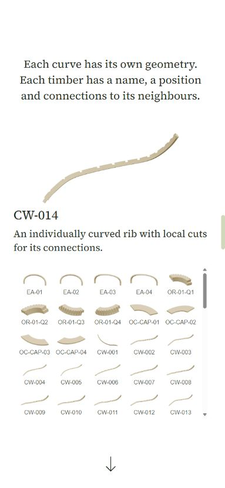

# Technology page release

Date: 2026-11-06

## What changed

The technology page connects the planted garden to the technical work behind it: coordinated curved geometry, timber families, connections, design checks and structural load studies. Earlier drawings and film remain dated; the current research prototype and remaining physical testing are described separately. Historical quantities are not presented as current product specifications.

The page uses the site's garden imagery, shared navigation and footer. The parts index introduces arches, ring components and ribs before handing all 92 parts to the visitor. Its first explanation holds for 3 seconds, and four progress segments show the remaining sequence. The continuation arrow appears at completion. Plant-load and load-direction diagrams explain their inputs without implying solved structural performance.

The release preserves main's existing Home, Process, Questions and Practice content and layouts. Technology opts into proximity snapping explicitly. Shared menu changes are limited to closing after a link is selected and keeping navigation clear of the logo on short landscape phones.

## Mobile review

Three passes covered layout, interaction/accessibility, and release validation. Responsive widths: 320, 360, 390, 430, 768 and 844 pixels; menu also checked at 568 x 320.

| Before | After | Why |
| --- | --- | --- |
| Phone parts frame exceeded 1,000 pixels | Explanation, inspector and scrollable index fit the 390 x 844 frame | Visitors can follow the presentation without losing its text |
| Narrow index columns wrapped identifiers | Five columns on phones, four on the smallest screens | Keeps identifiers readable and touch targets above 44 pixels |
| Index scrolling could move the document at its boundary | Contained vertical overscroll | Browsing parts does not unexpectedly leave the frame |
| Diagram labels shrank with the SVG | Separate HTML labels, minimum 12 pixels | Labels remain legible on phones and tablets |
| Current-page navigation left the menu open | Link activation closes the menu | A tap has the expected result even on the same route |
| Landscape menu began underneath the logo | Compact 44-pixel links in normal top alignment | All five destinations fit in a 568 x 320 viewport |

Motion verdict: approve. The explanatory sequences run once, stop on departure or manual interaction, and use transform/opacity. Keyboard selection is immediate. Reduced motion exposes the complete index immediately and prevents film autoplay. The assembly film is muted, inline, uses the 480-pixel source on phones, and pauses outside the viewport. It retains the poster if playback is unavailable.

Verified no document overflow, readable captions, intact image proportions, index selection, keyboard navigation through the final part, continuation link, menu open/close, current-page navigation, and footer layout. Real-device iOS Safari and Android touch feel, browser chrome and safe areas were not tested; responsive browser review is not a substitute for hardware testing.

## Release checks

- Typecheck passed.
- Full suite: 1,000 tests across 81 files passed.
- Production build passed. Existing unresolved Inter-variable.ttf warning remains.
- Production bundle gate passed: private engine routes and the three.js stack remain excluded. Its stale homepage positive control was updated to current published copy.
- Generated public text mirrors are current; routing, SEO and house-rule checks pass.
- The manifest now names the Vite, React plugin and Vitest versions already in the lockfile and installed environment. This resolves the existing clean-install mismatch without changing the locked dependency tree.
- Staged secret scan and clean-install lockfile validation passed. Remote deployment checks are required before merge.

## Evidence and verification

Open `/tech` at phone portrait and landscape sizes. Let the parts sequence complete, select another part, then follow the down arrow. Open the menu and select Technology while already on this page. In reduced motion, confirm the full parts index is immediately available and the film remains still.

Technical reference: current engine reviewed at [b77534e](https://github.com/danielguerrarmz-create/bower-engine/tree/b77534e4fbbb1602c1d4ada24906cb863428d0e8). Earlier gridshell illustration data: [c55424c](https://github.com/danielguerrarmz-create/bower-engineering/tree/c55424cf8f9062fbfd0874067c5f7a91f0e6a6a6). The timber illustrations are display meshes from the September R13 model, not fabrication output.

## Files touched

Technology page and components under `src/pages/tech`, static illustrations under `public/assets/tech`, route/metadata/text-mirror integration, `EditorialHeader` mobile navigation, illustration-generation scripts and the bundle-check positive control. Unrelated preview experiments and local review logs are excluded from the release.

## What's left

Physical-device smoke testing and the engineering/testing work stated on the page. Neither blocks the verified website rendering behavior, and neither is represented as completed.
